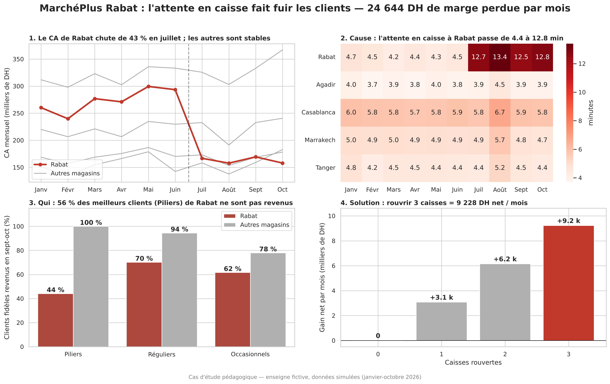
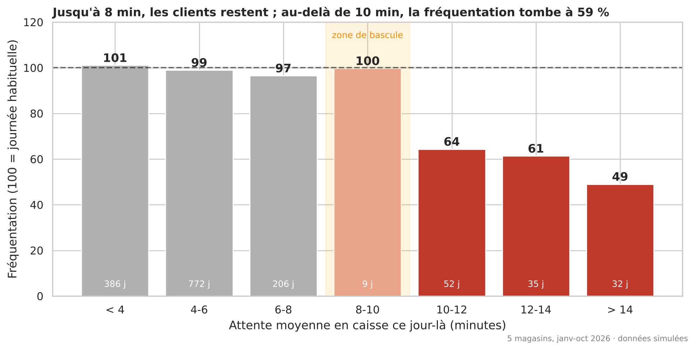

# 🕵️ Le mystère des clients disparus — Analyse de données avec Python

**En juillet, le magasin de Rabat perd 43 % de son chiffre d'affaires en un mois. J'ai enquêté sur 33 000 tickets de caisse pour trouver pourquoi, chiffrer la perte et recommander une solution rentable.**

> **Cas d'étude pédagogique** réalisé dans le cadre de la formation *Python pour l'analyse des données* (sup2tech).
> MarchéPlus est une enseigne **fictive** et les données sont **simulées**.



## 🎯 Le problème

Depuis l'été, le magasin de Rabat de la chaîne MarchéPlus perd des clients, alors que les 4 autres magasins vont bien.
Le directeur commercial voulait savoir : **est-ce vrai, pourquoi, qui est parti, combien ça coûte et que faire ?**

## 🗂️ Les données

| Fichier | Contenu | Taille |
|---|---|---|
| `tickets.csv` | Passages en caisse (janvier → octobre 2026) | 33 679 lignes |
| `clients.csv` | Clients de la carte fidélité | 1 762 lignes |
| `magasins.csv` | Les 5 magasins | 5 lignes |
| `attente_caisse.csv` | Temps d'attente moyen en caisse, par jour et par magasin | 1 520 lignes |

## 🧹 Qualité des données

| Problème trouvé | Lignes | Décision | Pourquoi |
|---|---|---|---|
| Tickets en double | 150 | Supprimés | Import en double : ils gonflaient le CA |
| Noms de magasin mal saisis (`rabat`, `RABAT `, `tanger `…) | 519 | Corrigés (`strip` + `title`) | Sinon Rabat aurait été coupé en 3 magasins |
| Dates au format `AAAA/MM/JJ` | 1 008 | Converties en date | Indispensable pour calculer mois et jour |
| Montants négatifs (`nb_articles = -1`) | 60 | Exclus des ventes | Ce sont des retours (0,17 % du CA), pas des visites |
| `client_id` vide | 9 771 | Conservés | Clients sans carte fidélité : ventes réelles |
| Clients en double | 12 | Supprimés | Un client = une ligne |
| `magasin_principal` mal saisi | 25 | Corrigés | Même règle que les tickets |
| `tranche_age` vide | 35 | « Inconnue » | On garde ces clients pour la rétention |
| `date_inscription` vide | 20 | Laissée vide | Inventer une date fausserait l'ancienneté |
| `attente_min` vide | 28 | Laissée vide | Les moyennes ignorent les vides ; mettre 0 aurait sous-estimé l'attente |

## 🔍 Démarche

1. **Contrôle qualité et nettoyage** des 4 fichiers
2. **Constat** : comparaison de Rabat avec les autres magasins, mois par mois ; CA = tickets × panier moyen
3. **Cause** : croisement des ventes avec le temps d'attente (`merge`), corrélation, jugement de 5 suspects
4. **Segmentation** des clients fidèles (Piliers, Réguliers, Occasionnels) et taux de rétention par segment
5. **Analyse par jour de la semaine**
6. **Coût** du problème et **simulation** de 4 scénarios (régression linéaire avec NumPy)

## 📊 Résultats clés

- 📉 Le CA de Rabat a chuté de **43 % en juillet** et reste **40 % sous son niveau** de janvier-juin, alors que les autres magasins sont stables (**+2 %** en moyenne).
- 🧾 Ce sont les **visites** qui disparaissent (**−40 %** de tickets), pas le panier moyen (**−1 %**).
- ⏱️ Au même moment, l'attente en caisse à Rabat est passée de **4,4 à 12,8 minutes** (corrélation avec le nombre de tickets : **−0,98**). Été, hausse des prix de mai et fermeture ont été écartés chiffres à l'appui.
- 👥 Seuls **44 % des meilleurs clients (Piliers)** de Rabat sont revenus, contre **100 %** dans les autres magasins.
- 📅 Le vendredi et le samedi sont les jours les plus touchés : **15 min d'attente** et **−52 % de visites** (contre −35 % les autres jours).
- 💰 Coût estimé : **≈ 24 600 DH de marge perdue par mois** (469 000 DH de CA perdus en 4 mois), pour une économie de salaires de **13 500 DH par mois**¹ : l'économie coûte **1,8 fois** ce qu'elle rapporte.

## 💡 Recommandations

1. **Rouvrir les 3 caisses fermées à Rabat** : l'attente revient à ≈ 4,4 min, ≈ 335 tickets regagnés par mois, **gain net estimé ≈ +9 200 DH par mois** (≈ 110 000 DH par an).
2. **Fixer un objectif d'attente de 8 minutes maximum**, avec du renfort en priorité le **vendredi et le samedi**.
3. **Relancer les 158 clients fidèles** absents depuis le 1er septembre, en commençant par les **33 Piliers** (liste livrée : `clients_a_relancer_rabat.csv`).

¹ *Les informations RH (nombre de caisses fermées, coût d'une caisse) sont des hypothèses de travail : 3 caisses à 4 500 DH par mois. Elles se modifient en deux lignes dans la partie 6.2 du notebook.*

## 🙋 Ma question personnelle

**À partir de combien de minutes d'attente les clients décrochent-ils ?**
Sur les 5 magasins (≈ 1 500 journées), la fréquentation reste normale tant que l'attente est sous **8 minutes (99 %** du niveau habituel), puis tombe à **59 % au-delà de 10 minutes**. C'est l'objectif opérationnel à donner au directeur de Rabat. Casablanca, à 6,7 min en août, est le prochain magasin à surveiller.



## 🛠️ Outils

Python · **NumPy** · **pandas** · **Matplotlib** · **Seaborn** · Jupyter / Google Colab

## 📁 Structure du dépôt

```
├── README.md
├── analyse_clients_disparus.ipynb
├── clients_a_relancer_rabat.csv      ← bonus : liste pour le service marketing
├── requirements.txt
├── data/
│   ├── tickets.csv
│   ├── clients.csv
│   ├── magasins.csv
│   └── attente_caisse.csv
└── images/
    ├── tableau_de_bord.png
    └── question_personnelle.png
```

## ▶️ Reproduire l'analyse

1. Cloner le dépôt, ou ouvrir le notebook dans Google Colab : la première cellule demande de téléverser les 4 CSV
2. Installer les bibliothèques : `pip install -r requirements.txt`
3. Exécuter le notebook de haut en bas

## 📚 Ce que j'ai appris

- **Toujours vérifier un fichier avant de calculer** : 150 doublons et 519 noms mal saisis auraient faussé tout le constat.
- **Comparer à un groupe témoin** : sans les 4 autres magasins, impossible d'écarter l'effet « été ».
- **Une corrélation ne suffit pas** : c'est la concordance (même date, même lieu, mécanisme logique, autres suspects écartés) qui prouve la cause.
- **Traduire en dirhams** : un comité de direction décide sur une marge perdue et un gain net, pas sur un coefficient.

## 📬 Contact

**DATIBAT — Data Analytics & Business Intelligence**

🌐 Site web : https://datibat.com

💼 LinkedIn : https://www.linkedin.com/company/datibat/

📘 Facebook : https://www.facebook.com/profile.php?id=61594630675017

📍 Maroc
